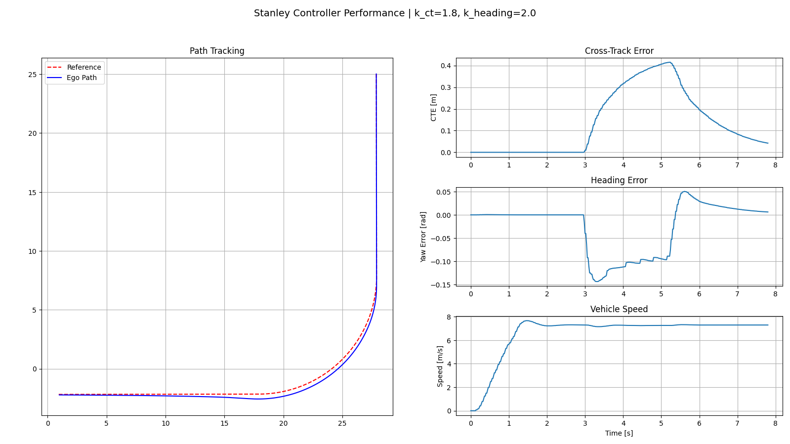
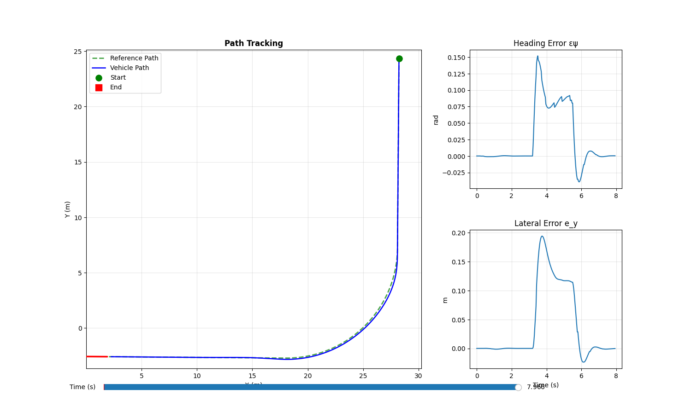

# CARLA + ROS 2 Control Stack  
**Stanley vs LQR Lateral Control with Service-Based Trajectory Generation**

---

## Overview

This repository implements a **ROS 2–based autonomous vehicle control pipeline** evaluated in the **CARLA simulator**.
The project focuses on **trajectory generation, coordinate frame transformation, and lateral control performance**
using two fundamentally different controllers:

- **Stanley controller** (geometric, error-based)
- **LQR controller** (model-based, dynamic bicycle formulation)

The emphasis is on *understanding controller behavior and modeling assumptions*, not perception or end-to-end autonomy.

---

## System Architecture

```
CARLA Simulator
      ↓
carla_ros_bridge
      ↓
Trajectory Generation Service (GenerateTrajectory.srv)
      ↓
Global Trajectory (World Frame)
      ↓
World → Ego Frame Transformation
      ↓
Lateral / Longitudinal Control
      ↓
CARLA Vehicle Actuation
      ↓
Logged Data → Offline Plotting
```

A key design choice is the use of a **ROS 2 service** for trajectory generation.
Once generated, the trajectory remains fixed, avoiding unnecessary topic traffic and keeping the control loop deterministic.

---

## Workspace & Package Structure

```
src/
├── carla_control/
│   ├── trajectory_service.py     # Trajectory generation (ROS 2 service)
│   ├── stanley_controller.py     # Stanley lateral controller
│   ├── lqr_controller.py         # Dynamic bicycle LQR controller
│   ├── traj_plot.py              # Offline plotting utilities
│   └── carla_demo1.py
│
└── carla_control_interfaces/
    └── srv/
        └── GenerateTrajectory.srv
```

---

## Trajectory Generation

- Trajectories are generated using a **ROS 2 service**
- Supported trajectory types include:
  - Straight
  - Right turn (circular arc)
  - S-curve
- The trajectory is returned in the **world frame**
- Discrete curvature is computed as:

```
κ = d(yaw) / ds
```

Curvature is later reused for **feedforward steering** in the LQR controller.

---

## Frame Transformation

- The received trajectory is transformed from the **world frame** into the **ego vehicle frame**
- Transformation uses the current ego pose from CARLA
- Controllers operate exclusively in the ego frame, which improves stability and interpretability

---

## Controllers

### Stanley Controller

- Geometric, error-based controller
- Uses:
  - Cross-track error (CTE)
  - Heading error
- Reactive in nature
- Robust and simple to tune
- Performance degrades at:
  - High speeds
  - Tight curvature
  - Rapid curvature transitions

---

### LQR Controller

- Model-based optimal state-feedback controller
- Based on a **linear dynamic bicycle model**
- State vector includes:
  - Lateral error
  - Lateral velocity
  - Heading error
  - Yaw rate
- Control structure:
  - **Feedforward**: curvature-based steady-state steering
  - **Feedback**: LQR stabilization and damping
- Gains are recomputed when vehicle speed changes significantly
- Low-speed gating is applied to avoid singularities

---

## LQR vs Stanley — Key Comparison

| Aspect | Stanley | LQR |
|------|--------|-----|
| Control philosophy | Geometric | Model-based |
| Vehicle dynamics | ❌ | ✅ |
| Feedforward action | ❌ | ✅ |
| High-speed behavior | Limited | Stable |
| Sensitivity to modeling | Low | High |
| Interpretability | High | High (with model) |

**Key insight:**  
LQR performance improvements come from **correct modeling and feedforward–feedback separation**, not simply more aggressive gains.

---

## Build Instructions

```bash
cd ~/carla_control_ws
colcon build
source install/setup.bash
```

Ensure:
- CARLA simulator is running
- `carla_ros_bridge` is active

---

## Runtime Procedure

### 1. Start Trajectory Service

```bash
ros2 run carla_control trajectory_service
```

---

### 2. Run Stanley Controller

```bash
ros2 run carla_control stanley_controller   --ros-args   -p trajectory_type:=right_turn   -p waypoint_spacing:=0.08   -p total_length:=50.0   -p v_ref:=8.0   -p turn_radius:=5.0
```

**Stanley tracking plot:**  
**

---

### 3. Run LQR Controller

```bash
ros2 run carla_control lqr_controller   --ros-args   -p trajectory_type:=right_turn   -p waypoint_spacing:=0.08   -p total_length:=110.0   -p v_ref:=30.0   -p turn_radius:=10.0
```

**LQR tracking plot:**  
**

---

## Live Road Reference & On-the-Fly Commands

The synthetic trajectories above are generated relative to the start pose and ignore the map,
so a turn can easily run off the road. Both controllers can instead track a **live road path**:

```
road_reference node
  odometry → CARLA map lane waypoints ahead of the car (rolling 40 m horizon, ~5 Hz)
           → nav_msgs/Path on /carla/ego_vehicle/road_reference
```

- The map is built client-side from the bridge's latched `/carla/world_info` OpenDRIVE,
  so the node never opens its own connection to the simulator.
- Junction behaviour is a live parameter: `straight | left | right | random`.

### Run

```bash
ros2 run carla_control trajectory_service
ros2 run carla_control road_reference
ros2 run carla_control stanley_controller --ros-args -p reference_source:=road -p wait_for_command:=true
# or: ros2 run carla_control lqr_controller --ros-args -p reference_source:=road -p wait_for_command:=true
```

### Commands (`std_msgs/String` on `<node>/command`)

| Command | Effect |
|---|---|
| `go [type] [L=..] [R=..] [v=..] [ds=..]` | (Re)plan from the **current** pose and start tracking |
| `speed <m/s>` | Change `v_ref` while driving |
| `stop` | Brake and hold; node stays alive for the next `go` |

```bash
ros2 topic pub --once /stanley_controller/command std_msgs/msg/String "{data: 'go v=8'}"
ros2 param set /road_reference junction_choice left
ros2 topic pub --once /stanley_controller/command std_msgs/msg/String "{data: 'stop'}"
```

- `reference_source` defaults to `service` and `wait_for_command` to `false`, so the original
  workflow above is unchanged.
- In command mode every `go` writes its own `run_<timestamp>_ego_path.csv`, so runs never
  overwrite each other.
- Command topics: `/stanley_controller/command`, `/roar_lqr_controller/command`.

### Result: same road, same start pose, 8 m/s (Town05, right turns at junctions)

| Controller | max \|cross-track error\| | RMS |
|---|---|---|
| Stanley | 0.161 m | 0.062 m |
| LQR (dynamic bicycle + feedforward) | 0.044 m | 0.012 m |

First 10 m excluded (LQR is gated off below 3 m/s, so it does not steer during the
pull-away). Data: [`results/stanley-vs-lqr.csv`](results/stanley-vs-lqr.csv)
(628 rows, 0.5 m bins over 314 m; columns `s_m, speed_stanley_mps, cte_stanley_m, cte_lqr_m,
heading_err_*, steer_*`). Runs are aligned on distance along the route, since the controllers tick at different rates.

### Reproducing (`tools/sim/`)

```bash
bash tools/sim/start_stack.sh                    # CARLA → Town05 → bridge (lockstep) → services
ros2 param set /road_reference junction_choice right
python3 tools/sim/rec.py start $PWD/tools/sim/recordings/stanley.log
bash tools/sim/road_run.sh stanley 45 8          # same start pose for both controllers
python3 tools/sim/rec.py stop
# ...repeat for lqr...
python3 tools/sim/build_comparison.py stanley-vs-lqr.csv
bash tools/sim/stop_ros.sh                       # keep CARLA, stop ROS side
python3 tools/sim/replay_cam.py tools/sim/recordings/stanley.log <ego_id> tools/sim/frames/stanley
bash tools/sim/kill_stack.sh                     # stop everything
```

Stability notes (CARLA 0.9.14): streaming a chase camera to `carla_manual_control` made the server
segfault within a minute or two, so the stack spawns the ego with odometry/control only and renders
video afterwards from a CARLA recording (`replay_cam.py`, fixed 1/30 s step → true-speed video).
The bridge runs in lockstep (`synchronous_mode_wait_for_vehicle_control_command`), so the simulation
advances one tick per control command.

---

## Logging & Analysis

Both controllers log:
- Cross-track error
- Heading error
- Steering commands
- Vehicle states

to generate performance plots.

---

## Scope & Assumptions

- Ground-truth state feedback
- Ideal actuation
- No perception or localization noise

These experiments establish a **clean baseline** for controller behavior.

---

## Future Work

- Introduce estimation uncertainty and sensor noise
- Study robustness under degraded state feedback
- Extend to dynamic replanning scenarios
- Integrate perception and localization pipelines

---

## Motivation

This project was built to understand **why controllers behave the way they do**, not just how to implement them.
The focus is on **modeling correctness, control structure, and system-level reasoning**.
